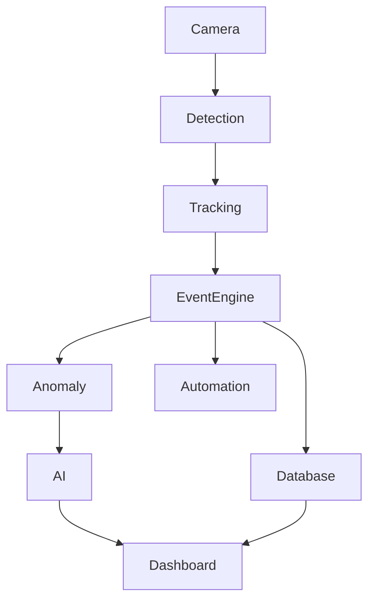

# 👁️ VisionOps AI

> Open-source real-time computer vision platform for object detection, tracking, event monitoring, anomaly detection, and AI-powered automation.

## Hero

VisionOps AI turns live camera streams into structured operational intelligence. It ingests video, detects objects, assigns tracking IDs, evaluates monitoring zones, raises events, stores records in SQLite, and presents a live dashboard for operators.

## Demo

- Backend API: http://localhost:8000
- API docs: http://localhost:8000/docs
- Frontend dashboard: http://localhost:3000

## Features

- Real-time object detection using YOLO with local processing
- Persistent tracking IDs across frames
- Zone management for restricted or monitored areas
- Event engine with dwell-time and cooldown logic
- Baseline anomaly detection with explainable reasoning
- Optional AI summarization layer with provider abstraction
- FastAPI REST API and SQLAlchemy persistence
- React + TypeScript monitoring dashboard
- Docker and GitHub Actions support

## Architecture



## Tech stack

- Python 3.11+
- FastAPI
- OpenCV
- NumPy
- Ultralytics YOLO
- SQLAlchemy + SQLite
- React + Vite + TypeScript
- Docker + Docker Compose
- pytest + GitHub Actions

## Screenshots placeholders

This project is intended for a local development environment. Use the live dashboard and API docs to inspect real detections and events as they are generated.

## Installation

```bash
python3 -m venv .venv
source .venv/bin/activate
pip install -r backend/requirements.txt
cd frontend && npm install
```

## Local development

Backend:

```bash
cd backend
uvicorn app.main:app --reload --host 0.0.0.0 --port 8000
```

Frontend:

```bash
cd frontend
npm run dev -- --host 0.0.0.0 --port 3000
```

Docker:

```bash
docker compose up --build
```

## API

The backend exposes REST endpoints for health, detections, events, zones, metrics, and dashboards. See the OpenAPI docs at http://localhost:8000/docs.

## Vision pipeline

- Camera capture
- Frame preprocessing
- YOLO detection
- Tracking and ID assignment
- Monitoring zone checks
- Event generation and persistence

## Event engine

Supported event types include `PERSON_ENTERED_ZONE`, `PERSON_LEFT_ZONE`, `OBJECT_STATIONARY`, `UNUSUAL_DWELL_TIME`, `MULTIPLE_PEOPLE_DETECTED`, and `CAMERA_OFFLINE`.

## AI reasoning

Optional AI integration is supported through a provider abstraction. If no model/API key is configured, the system gracefully falls back to local rule-based summaries.

## Automation

Automation actions include dashboard notifications, local logs, and configurable webhooks. External webhooks are disabled unless set in the environment.

## Testing

```bash
cd backend
pytest -q
```

## Privacy

- Webcam frames are processed locally by default.
- No webcam video is uploaded anywhere by default.
- No secrets or API keys are committed to the repository.
- Users retain control of their own data and local storage.

## Security

- API keys are read from environment variables only.
- Webhooks must be explicitly enabled.
- AI features are optional and off by default.

## Roadmap

- [x] Real-time object detection
- [x] Object tracking
- [x] Monitoring zones
- [x] Event engine
- [x] Local event storage
- [x] REST API
- [x] Dashboard
- [x] Baseline anomaly detection
- [x] Optional AI reasoning
- [x] Webhook automation
- [x] Tests
- [x] Docker
- [x] CI

Future:

- [ ] Custom trained anomaly model
- [ ] Multi-camera support
- [ ] Advanced multi-object tracking
- [ ] Edge-device optimization
- [ ] GPU acceleration

## Contributing

Contributions are welcome. Please open an issue or submit a PR with tests and documentation updates.

## License

This project is released under the MIT License.

---

For more details, see the docs folder and the backend/frontend source code.
